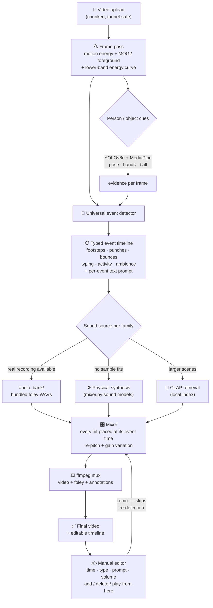

# 🎬 SnapFoley — real foley for any video, 100% offline

**Track: Soundscapes & Composition — Music & Audio Studios**

> ### 💡 Problem statement (from the track)
> *Independent indie game developers, filmmakers, and podcast producers lack real-time adaptive soundscapes tailored to dynamic emotional pacing.*

---

## The problem, in practice

Sound is half of every video — and it's the half creators can't afford:

- **Foley is expensive.** A recording session, an artist, a treated room. Indie creators have none of these.
- **Stock libraries don't match.** You find "a" punch sound, but not *that* punch at *1.42 s*, in sync, at the right weight, on the right surface. Syncing 20 mismatched clips by hand takes hours.
- **Cloud AI sound APIs are a trap for this audience.** Per-call pricing, API keys, upload privacy concerns for raw footage, and services that fail exactly when you're demoing.

The result: silently bad videos, or no video at all.

## Our solution — SnapFoley

**SnapFoley watches any video, finds every sound-producing moment, and renders a matching foley track at the exact frames — then hands you a timeline where every sound is editable.**

1. **Watch** — a fast frame pass (motion energy + MOG2 foreground + YOLOv8n/MediaPipe person cues) finds the moments sound *must* happen: every punch, every ball contact, every footstep, every keypress.
2. **Describe (zero-shot, text-cued)** — each detected event gets a text prompt like *"footsteps on brick pavement with fallen leaves, close-mic"* — the same way you'd brief a foley artist. Surface and material words steer how the sound is voiced.
3. **Sound** — every event is rendered from **real recorded foley one-shots** (bundled in-repo), re-pitched per hit so nothing loops; physical sound-synthesis models fill any gap no sample covers.
4. **Edit like a human** — a full manual audio editor: move any sound to any second, retype what it should sound like, set its volume, delete it, add one at the playhead, hit ▶ to check sync — and re-render in seconds. No re-detection needed.

Everything runs **100% locally**: no API keys, no cloud calls, no internet at runtime. Raw footage never leaves the machine.

**50%-MVP scope (this repo):** the foley/SFX half of an adaptive soundscape studio — detection → text-cued foley → frame-accurate render → human edit loop — is complete and demo-ready. The next half (adaptive **music** stems that follow scene tension) builds on the same event timeline and is detailed in the roadmap below.

---

## Architecture

**Why these choices:** one universal detector (not per-action models) means *any* video gets sound; contact events are re-timed to the physics ("the ball stops moving" frame), not to a smoothed curve peak; and the manual editor makes the system usable even when detection isn't perfect — the human always has the last word.

## Demo numbers (verified end-to-end)

| Test video | What SnapFoley found | Sync check on the final render |
| --- | --- | --- |
| Boxing (heavy bag) | 17 punches | 17/17 sounds within ~40 ms |
| Basketball (handheld, dark court) | 10 floor contacts, timed to the contact frame | 10/10 |
| POV walk (brick pavement, leaves) | 14 steps, leafy-surface voicing | 14/14, crunch audible |
| Laptop typing | 26 key strikes | unchanged, accepted |

## Web UI
Served at `/` — upload a video, watch detection progress, play the final video with foley, then edit every sound in the manual editor and re-render.

## API
| Endpoint | Method | Purpose |
| --- | --- | --- |
| `/api/health` | GET | liveness + ffmpeg info |
| `/api/upload-chunk` / `/api/upload-complete` | POST | chunked upload (tunnel proxies cap body size) |
| `/api/process/{id}` | POST | detect events |
| `/api/status/{id}` | GET | processing progress |
| `/api/timeline/{id}` | GET | event timeline JSON |
| `/api/remix/{id}` | POST | apply edited events (time/type/prompt/volume) + re-render |
| `/api/generate-audio-video/{id}` | POST | build final video with foley |
| `/api/download-audio-video/{id}` | GET | final mp4 download |
| `/api/export-csv` / `/api/export-json` | GET | timeline exports |

## Run in GitHub Codespaces — stable public URL (free)

1. On the repo page: **Code → Codespaces → Create codespace on `main`** (4-core/8GB is auto-requested)
2. First build takes ~5–8 min (ffmpeg + python deps install automatically; the server auto-starts)
3. If it isn't up yet, run: `./start_snapfoley.sh`
4. Open `https://<codespace-name>-7860.app.github.dev` — **the URL is stable across restarts**
5. If the page asks you to log in to GitHub: Ports panel → right-click 7860 → Port Visibility → Public

Free tier: 120 core-hours/month (≈30 h on 4 cores). Auto-stops after 30 min idle; restart → same URL.

**Run anywhere with Python 3.10–3.11:** `pip install -r requirements-cloud.txt`, `ffmpeg` on PATH, `git lfs install && git lfs pull` (fetches the real audio samples), then `uvicorn app.main:app --port 7860`.

## Why everything is local — deliberate, not a limitation

1. **Demo-critical reliability:** cloud AI fails at demo time — rate limits, expired keys, dead Wi-Fi. SnapFoley runs off a laptop battery or a free Codespace.
2. **Zero cost, forever:** every "good" foley API charges per call. SnapFoley's sounds are bundled recordings (Mixkit + CC0 — see `audio_bank/CREDITS.md`) and physical synthesis models in `app/mixer.py`.
3. **Privacy:** raw, unedited footage never leaves the machine. No accounts, no quotas.

## Roadmap — the next 50%

- **Adaptive music stems** keyed to the same event timeline: tension per scene → arrangement shifts (the track's "dynamic emotional pacing")
- **Realtime preview** with the Web Audio API: scrub the video, hear foley + stems live
- **MIDI/stream export** of the event timeline for DAWs and game engines
- **Zero-shot foley expansion:** more surfaces/materials from text cues alone

## For teammates

- **Zero setup on Codespaces:** `.devcontainer/setup.sh` installs ffmpeg + deps; `postStartCommand` auto-launches the server.
- **Models are in the repo:** `yolov8n.pt` is committed; detectors degrade gracefully to the motion fallback if MediaPipe/YOLO weights are missing — detection always returns events.
- **All sound rendering is in `app/mixer.py`;** the `audio_bank/` recordings are committed via git-LFS (`git lfs pull` after cloning).
- **Verify a change:** `python qa_loop.py` must be 7/7 green; then upload the demo videos through the UI and check the timeline (boxing → 17 punches, basketball → 10 bounces, typing → keystrikes, POV walk → 14 steps).

## QA
`python qa_loop.py` must be green before shipping (writes `qa_report.json`).
